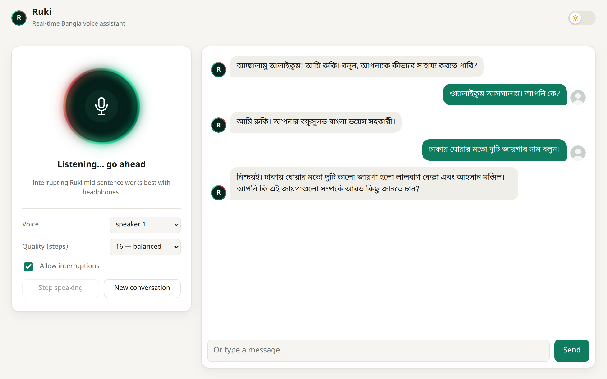
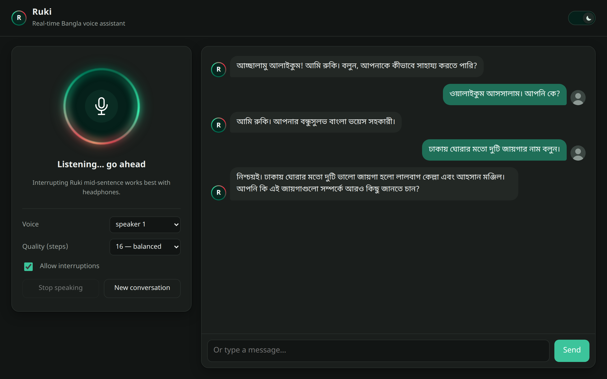

# Ruki

**Ruki** is a real-time Bangla voice assistant. Talk to it in Bangla and it talks back. It listens through the
browser microphone, understands you with a local speech recognizer, answers with Gemini or an Ollama model, and
speaks the answer with a local voice-cloning TTS while it is still being written.



## Features

- **Spoken conversation in Bangla.** Speech recognition and speech synthesis run locally; only the text goes to
  Gemini.
- **Greets you first.** When you turn on the microphone, Ruki opens with a welcome that fits the time of day
  on your computer (“শুভ সকাল! আমি রুকি। …”) and then listens.
- **Natural turn taking.** A pause ends your turn. You can interrupt Ruki mid-sentence (barge-in) and it stops
  and listens.
- **Streaming replies.** Speech starts after the first sentence of the answer, not after the whole answer.
- **Typed messages** work alongside voice.
- **Remembers the conversation.** Each reply takes the recent conversation into account, also after the
  microphone is turned off and on again.
- **Gemini or Ollama.** Choose the language model in Settings, including an Ollama server on another computer.
- **Voice cloning from the browser.** Upload a short recording in Settings and Ruki speaks in that voice.
- **Light and dark mode**, with a switch in the top-right corner.
- **Debug view** (`LOG_LEVEL=DEBUG`): each turn shows its timing breakdown, and the header lists the models.

## How it works

```
browser mic ──16 kHz──▶ denoise ─▶ voice activity ─▶ speech-to-text ─▶ Gemini (streamed) ─▶ text-to-speech ──24 kHz──▶ speaker
                         GTCRN      Silero VAD         Hima-ASR          sentence by           OmniVoice
                         └────── turn taking, barge-in ──────┘           sentence              GPU (Vulkan)
```

The browser streams microphone audio over a WebSocket to a FastAPI server. Each conversation gets its own
pipeline of four threads joined by queues:

| Stage | What it does | Passes on |
|---|---|---|
| `VADHandler` | Denoises each 32 ms frame, detects speech, decides when you have finished, detects barge-in | your utterance (audio) |
| `STTHandler` | Transcribes the utterance with Hima-ASR (Bangla) | your text |
| `LLMHandler` | Streams Gemini's reply, given the conversation history, and cuts it at `।` `?` `!` | one sentence at a time |
| `TTSHandler` | Synthesizes each sentence with OmniVoice and streams the audio to the browser | audio |

The models are loaded once and shared by all conversations. The design follows
[huggingface/speech-to-speech](https://github.com/huggingface/speech-to-speech): queue-based stage threads, a
VAD iterator that cuts the microphone stream into utterances, and a cancel counter that stops every stage at once
when you interrupt.

## Requirements

- Linux x86-64, conda
- A GPU with a Vulkan driver for the TTS (it also runs on the CPU, much more slowly)
- A Gemini API key
- About 1.5 GB for the models in `models/`
- A modern browser (Chrome, Edge or Firefox)

## Quick start

```bash
git clone https://github.com/nahidbrur/ruki-ai.git
cd ruki-ai
conda env create -f environment.yml
conda activate banglavoice
cp .env.example .env              # then put your key(s) in GEMINI_API_KEYS
python -m ruki.server      # open http://localhost:8000
```

Click the microphone and allow microphone access. Ruki greets you; then speak Bangla.

- **Open the page on `localhost`** (or `127.0.0.1`). Browsers only allow the microphone on secure pages, so
  another machine needs the server behind HTTPS.
- **Use headphones** for the smoothest interruptions. Echo cancellation is on, but loud speakers can still leak
  Ruki's voice back into the microphone.

Command-line options: `--host`, `--port`, `--tts-device`, `--tts-steps`, `--no-interruptions` and `--log-level`.
Everything else is set in `.env`.

## Using the web UI

| Control | What it does |
|---|---|
| Microphone button | Starts a conversation (Ruki greets you). While a conversation runs, click it to end the session. Its glow follows your voice and Ruki's. |
| Status line | What Ruki is doing: Listening, Understanding, Thinking or Speaking |
| Voice | The reference voice Ruki speaks with |
| Quality (steps) | TTS quality versus speed: 8 fastest, 16 balanced, 32 best |
| Allow interruptions | On: speaking over Ruki stops it. Off: the microphone is ignored while Ruki speaks. |
| Stop speaking | Stops the current reply |
| New conversation | Clears the history; Ruki greets you again |
| Message box | Type instead of speaking |
| Gear button | Settings: choose the language model (Gemini or Ollama), clone a new voice from a recording |
| Sun/moon switch | Light or dark mode; your choice is remembered |



## Configuration

All settings are read from `.env`; [.env.example](.env.example) lists them with comments. The ones you are most
likely to change:

| Setting | Default | Purpose |
|---|---|---|
| `LLM_PROVIDER` | `gemini` | `gemini` or `ollama` (Settings in the UI overrides it, see below) |
| `OLLAMA_URL`, `OLLAMA_MODEL` | `http://localhost:11434`, none | The Ollama server and model |
| `GEMINI_API_KEYS` | (required for Gemini) | One key, or several as a JSON list or comma-separated; the next key is used when one hits its quota |
| `GEMINI_MODEL` | `gemini-3.5-flash-lite` | Any model your key can use (`python scripts/check_gemini.py` lists them) |
| `SYSTEM_PROMPT` | Ruki's persona | Who Ruki is and how it answers (see [config.py](ruki/config.py)) |
| `WELCOME_MESSAGE` | “{time_greeting}আমি রুকি। …” | Spoken when a conversation starts; leave empty for no greeting. `{time_greeting}` becomes good morning / afternoon / evening / night by the user's local time |
| `LOG_LEVEL` | `INFO` | `DEBUG` also shows each turn's timing breakdown and the model names in the UI |
| `TTS_DEVICE` | `Vulkan1` | The Vulkan device for the TTS (`Vulkan0`, `Vulkan1`, …) or `CPU` |
| `TTS_STEPS` | `16` | Default TTS quality (8, 12, 16 or 32) |
| `DEFAULT_VOICE` | `Ayesha` | The voice selected when the page opens |
| `MAX_HISTORY_TURNS` | `12` | How many recent exchanges (your message + Ruki's reply) are sent to the LLM with each message |
| `VAD_MIN_SILENCE_MS` | `600` | Silence that ends your turn: lower answers sooner, higher cuts you off less |
| `ALLOW_INTERRUPTIONS` | `true` | Default for the interruptions checkbox |
| `BARGE_IN_MIN_MS`, `BARGE_IN_THRESHOLD` | `350`, `0.7` | How long and how clearly you must speak to interrupt Ruki |
| `HOST`, `PORT` | `127.0.0.1`, `8000` | Where the server listens |

## Language model: Gemini or Ollama

Open **Settings** (the gear button) > **Language model**:

- **Gemini:** paste one or more API keys (one per line; the next key is used when one hits its quota) and pick a
  model (**Load list** shows the ones your key can use). Saved keys are only ever shown masked.
- **Ollama:** enter the server address (for example `http://192.168.1.20:11434`; `http://` and the port are added
  if missing), click **Load models** and pick one.

**Save and test** sends one short request and switches only if the model answers; new messages use it right away,
in every open conversation. The choice is saved in `llm_settings.json` (kept out of git, readable only by you),
which takes precedence over `.env`. Delete that file to go back to the `.env` values.

Using Ollama on another computer:

- Start Ollama there so it accepts network connections: `OLLAMA_HOST=0.0.0.0 ollama serve` (for the system
  service, add `Environment="OLLAMA_HOST=0.0.0.0"` with `sudo systemctl edit ollama`, then restart it).
- Ruki turns a model's "thinking" off (`think: false`) and reuses the context size the model is already loaded
  with, because a different size makes Ollama reload the model for every request (seconds each time).
- Replies start later when the Ollama computer is busy with other requests: they wait in its queue.
- The settings page has no login. With the default `HOST=127.0.0.1` only this computer can open it; if you serve
  Ruki on the network, anyone who can open the page can change the model.

## Turn taking

- **End of turn:** `VAD_MIN_SILENCE_MS` of silence ends your turn. Very short sounds (coughs, clicks, under
  `VAD_MIN_SPEECH_MS`) are ignored.
- **Interrupting:** while Ruki is thinking or speaking, sustained and confident speech stops it. The reply is
  cancelled, the browser drops the audio it has buffered, and Ruki listens to you. Sounds during Ruki's turn that
  are too short or quiet to count as an interruption are treated as echo and ignored.
- **History after an interruption:** only the part of Ruki's reply that was actually spoken is kept, so the
  conversation history matches what you heard.
- **No interruptions** (`--no-interruptions`, or untick the box): the microphone is ignored while Ruki speaks.

## Conversation memory

Ruki keeps the conversation of the current chat. With each message, the most recent `MAX_HISTORY_TURNS`
exchanges are sent to the LLM along with it, so follow-up questions work ("what did I just say my name was?").
Turning the microphone off and on keeps the chat: the browser sends the messages on screen to the new session,
and Ruki continues without greeting again. **New conversation** clears the memory, and Ruki greets you again.

## Voices

Two voices are included, **Ayesha** (the default) and **Rebeka**. Every `voices/<name>.wav` (or `.mp3`, `.flac`,
`.ogg`) that has a matching `voices/<name>.txt` transcript is loaded at start-up and listed in the UI. Use 3-10 seconds of one clean speaker and the exact transcript of what is said; a longer recording
makes every reply slower.

**Cloning a voice in the browser:** open Settings (the gear button), upload a recording (WAV, MP3, M4A, OGG…),
and check the transcript, which is filled in automatically by the speech recognizer and may contain mistakes.
Then click **Create voice**. The browser trims silence and keeps at most 15 seconds. The new voice is saved
in `voices/user/` (kept out of git), selected right away, and available after restarts. Only clone voices you
have permission to use.

## Models

Only the files the pipeline loads are kept in `models/`:

| Folder | What | Source |
|---|---|---|
| `models/asr/hima-asr-onnx/` | Hima-ASR int8 (encoder, decoder, tokenizer) | [Prahaladha/hima-asr-ONNX](https://huggingface.co/Prahaladha/hima-asr-ONNX) |
| `models/vad/silero_vad_v6.onnx` | Silero VAD v6 | [snakers4/silero-vad](https://github.com/snakers4/silero-vad) |
| `models/denoise/gtcrn_simple.onnx` | GTCRN streaming noise suppression | [Xiaobin-Rong/gtcrn](https://github.com/Xiaobin-Rong/gtcrn) |
| `models/tts/omnivoice-*-Q8_0.gguf` | OmniVoice (8-bit) | [Serveurperso/OmniVoice-GGUF](https://huggingface.co/Serveurperso/OmniVoice-GGUF) |
| `models/tts/lib/` | `libomnivoice.so` and `libggml*.so`, a Vulkan build of omnivoice.cpp | built from omnivoice.cpp |
| `models/tts/omnivoice-cpp-fast-cfg-bengali.patch` | The patch those libraries were built with | |

To run the TTS on different hardware, rebuild omnivoice.cpp with that patch and copy the resulting `.so` files
into `models/tts/lib/`.

## Project layout

```
ruki-ai/
├── ruki/
│   ├── server.py              FastAPI app: web UI, /api/info, voice cloning API, WebSocket /ws
│   ├── session.py             one conversation: the four stage threads, history, greeting, interruptions
│   ├── config.py              settings from .env, Ruki's system prompt and welcome message
│   ├── pipeline/              stage base class, the four handlers, the messages between them
│   ├── vad/                   Silero VAD, GTCRN denoiser, utterance segmentation
│   ├── stt/hima.py            Hima-ASR
│   ├── llm/                   Gemini and Ollama clients, the switchable router (manager.py), sentence chunking
│   └── tts/omnivoice.py       OmniVoice via omnivoice.cpp
├── web/                       index.html, app.js, style.css, microphone and playback audio worklets
├── models/                    see Models
├── voices/                    reference voices: <name>.mp3/.wav + <name>.txt (user/: voices cloned in the UI)
├── scripts/                   test and diagnostic tools (see below)
├── docs/screenshots/
└── .env.example, requirements.txt, environment.yml
```

## Testing without a microphone

```bash
python scripts/test_pipeline.py question.wav --fake-llm      # a WAV through the pipeline, canned reply, no Gemini
python scripts/test_pipeline.py question.wav                 # the same with Gemini
python scripts/test_pipeline.py q1.wav --barge-in q2.wav --barge-after 1.0   # interrupt the reply
python scripts/ws_client.py q1.wav q2.wav --url ws://localhost:8000/ws       # against a running server
python scripts/check_gemini.py                               # which Gemini models your key can use
```

## WebSocket protocol

The full protocol is in the docstring of [ruki/server.py](ruki/server.py). In short: the client
sends `{"type": "start", ...}` and then binary 16 kHz float32 microphone audio. The server sends JSON events
(`status`, `vad`, `user_text`, `assistant_delta`, `audio_start`, `assistant_done`, `interrupt`, `error`) and
binary 24 kHz int16 audio. Typed messages, settings changes, interrupt and reset are JSON messages from the client.

Voice cloning uses two HTTP endpoints: `POST /api/transcribe` (a base64 WAV; returns the recognized text) and
`POST /api/voices` (name, transcript and base64 WAV; saves and registers the voice).

## Troubleshooting

| Problem | What to do |
|---|---|
| `No Gemini API key` | Set `GEMINI_API_KEYS` (or `GEMINI_API_KEY`) in `.env`. |
| Gemini says the model is not available | Run `python scripts/check_gemini.py` and set `GEMINI_MODEL` to one it lists. |
| `ov_init failed on Vulkan1` | Check the GPU driver and Vulkan support; your GPU may be `Vulkan0`. Set `TTS_DEVICE` accordingly. |
| The microphone does not start | Open the page through `localhost` and allow microphone access. |
| Ruki interrupts itself | Its voice is leaking into the microphone: use headphones, raise `BARGE_IN_MIN_MS` or `BARGE_IN_THRESHOLD`, or turn interruptions off. |
| Ruki cuts you off mid-sentence | Raise `VAD_MIN_SILENCE_MS` (for example to 800-1000). |

## Licenses

| Component | License |
|---|---|
| Hima-ASR | Apache 2.0, plus the **Gemma Terms of Use** for its text decoder (`models/asr/hima-asr-onnx/NOTICE`) |
| OmniVoice code / omnivoice.cpp | Apache 2.0 / MIT |
| **OmniVoice GGUF weights** | **CC-BY-NC 4.0: non-commercial use only** |
| Silero VAD, GTCRN | MIT |
| Pipeline design | adapted from huggingface/speech-to-speech (Apache 2.0) |
